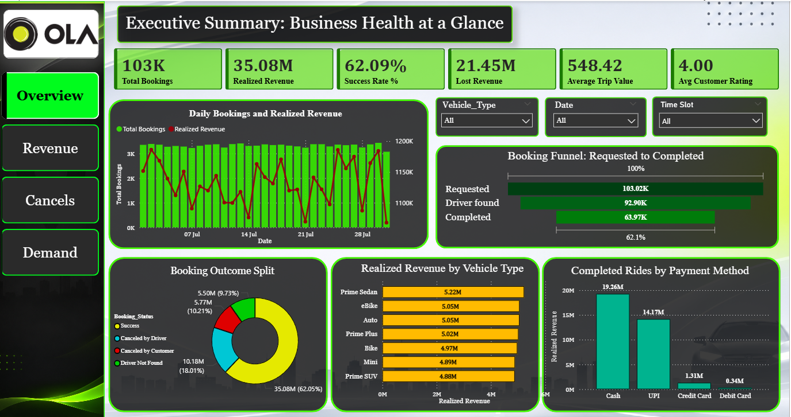

# 🚖 OLA Business Performance & Operational Analytics
### An End-to-End Data Analytics Project Using Excel, MySQL & Power BI


## 📌 Project Overview

A ride-booking business is not just about the number of rides completed or the revenue generated. Behind every successful booking, there are several operational factors involved, including driver availability, customer behaviour, pickup coordination, vehicle performance, and payment preferences.

For this project, I analysed OLA's booking data containing **103,024 records from July 2024** to understand how the business was performing and identify areas where operational inefficiencies could be affecting revenue and customer experience.

I wanted to go beyond creating charts and answering basic questions such as how many bookings were completed or how much revenue was generated.

The main focus was to investigate why nearly 38% of booking attempts were unsuccessful, understand how much booking value was associated with these failures, identify locations experiencing higher failure rates, and evaluate the relationship between customer demand and driver availability.

I used **Microsoft Excel, MySQL, and Power BI** to explore the data, perform business analysis, calculate key performance indicators, and develop an interactive four-page dashboard.

The project covers six major business problem areas, with findings translated into practical recommendations for improving booking conversion, operational efficiency, and revenue performance.

---

## 🎯 Business Problem Statement

Despite generating a considerable number of bookings, a ride-booking platform can face several operational challenges that affect its overall performance.

Some bookings are cancelled by drivers, some by customers, and others fail because no driver is available. These failures can affect customer satisfaction and create potential revenue exposure.

The objective of this analysis was to investigate the following business questions:

1. **Booking Conversion:** Why are a significant number of booking requests not converting into successful rides?
2. **Revenue Leakage:** How much booking value is associated with unsuccessful bookings, and which failure categories contribute the most?
3. **Driver Availability:** Which pickup locations experience higher driver shortages and booking failure rates?
4. **Cancellation Behaviour:** What are the major reasons behind driver and customer cancellations?
5. **Vehicle Performance:** Which vehicle categories contribute the most revenue and demonstrate better booking performance?
6. **Demand & Supply Planning:** How do booking demand and success rates vary across different locations, weekdays, and time periods?

These questions formed the foundation of the entire analysis.

## 📂 Dataset Overview

| Dataset Attribute | Details |
|---|---|
| Dataset | OLA Bookings |
| Total Records | 103,024 |
| Total Columns | 21 |
| Analysis Period | July 2024 |
| Unique Customers | 94,544 |
| Pickup Locations | 50 |
| Drop Locations | 50 |
| Vehicle Categories | 7 |
| File Format | CSV |

### Important Dataset Columns

- Booking_ID
- Date and Time
- Customer_ID
- Booking_Status
- Vehicle_Type
- Pickup_Location
- Drop_Location
- Booking_Value
- Payment_Method
- Ride_Distance
- Driver_Ratings
- Customer_Rating
- Canceled_Rides_by_Customer
- Canceled_Rides_by_Driver
- Incomplete_Rides
- Incomplete_Rides_Reason
- V_TAT and C_TAT

## 🛠️ Tools & Technologies

### Microsoft Excel — Data Preparation & Analysis

Excel was used for exploring the dataset, preparing analytical fields, and developing interactive dashboards.

Key activities:
- Initial data exploration and cleaning.
- Handling missing and inconsistent values.
- Creating calculated columns and business metrics.
- Working with Excel formulas and conditional calculations.
- Pivot tables and pivot charts.
- Conditional formatting and data visualization.
- KPI cards, slicers, and interactive dashboard navigation.

### MySQL — Data Querying & Business Analysis

MySQL was used to investigate the dataset through structured queries and answer business-related questions.

Key activities:
- Importing the CSV dataset into MySQL.
- Understanding data structure and column behaviour.
- SELECT, WHERE, ORDER BY, and GROUP BY.
- Aggregate functions and conditional calculations.
- CASE statements.
- Date and time-based analysis.
- Cancellation and booking performance analysis.
- Revenue analysis by vehicle category and booking status.
- Location-level and operational comparisons.

### Power BI — Business Intelligence & Visualization

Power BI was used to develop an interactive dashboard that presents the findings in a business-friendly format.

Key activities:
- Power Query transformations.
- Data modelling.
- DAX measures and calculated columns.
- KPI development.
- Interactive slicers and filters.
- Time-based trend analysis.
- Geographical demand and failure analysis.
- Heatmaps, funnel charts, waterfall charts, and treemaps.
- Dashboard navigation and visual formatting.

---

# 📊 Key Business Findings

The following findings are based on the uploaded dataset and the metrics displayed in the dashboards.

## 1. Booking Performance & Conversion Analysis

Out of 103,024 total booking attempts, only 63,967 resulted in successful rides.

| Booking Status | Total Bookings | Percentage |
|---|---:|---:|
| Success | 63,967 | 62.09% |
| Canceled by Driver | 18,434 | 17.89% |
| Canceled by Customer | 10,499 | 10.19% |
| Driver Not Found | 10,124 | 9.83% |
| **Total** | **103,024** | **100%** |

### What I found

- Only 62.09% of booking attempts resulted in successful rides.
- Driver cancellations represent the largest individual failure category.
- Customer cancellations account for 10.19% of bookings.
- Another 9.83% of bookings could not find an available driver.

### Business interpretation

The booking conversion rate indicates that a considerable proportion of booking attempts are not reaching completion.

Driver-side cancellations and availability issues together account for 27.72% of all booking attempts. This makes driver availability, vehicle readiness, and pickup coordination important areas for further investigation.

## 2. Revenue Leakage & Financial Exposure

One of the most important parts of this project was understanding the financial value associated with unsuccessful bookings.

| Financial Metric | Value |
|---|---:|
| Total Booking Value | ₹56.53M |
| Realized Revenue | ₹35.08M |
| Booking Value of Unsuccessful Rides | ₹21.45M |
| Revenue at Risk Percentage | 37.95% |
| Average Successful Booking Value | ₹548.42 |
| Average Successful Ride Distance | 22.85 KM |

### What I found

Approximately ₹21.45M in booking value is associated with unsuccessful booking attempts.

The revenue leakage calculation shows that 37.95% of the total booking value is associated with bookings that did not result in successful rides.

### Business interpretation

This highlights a significant opportunity to investigate booking failures from a financial perspective.

Reducing unsuccessful bookings could potentially improve the number of completed rides and increase realized revenue. However, the booking value associated with unsuccessful rides is an estimate of revenue at risk, not confirmed financial loss or guaranteed recoverable revenue.

## 3. Driver Availability & Pickup Location Analysis

Location-level analysis helped identify where booking failures and driver availability issues are more prominent.

### Top pickup locations by overall failure rate

| Pickup Location | Failure Rate |
|---|---:|
| Vijayanagar | 40.18% |
| Langford Town | 39.87% |
| Hosur Road | 39.83% |
| Tumkur Road | 39.71% |
| Kengeri | 39.65% |

### Locations with higher Driver Not Found rates

| Pickup Location | Driver Not Found Rate |
|---|---:|
| Marathahalli | 11.10% |
| Hennur | 10.91% |
| Peenya | 10.63% |
| Kadugodi | 10.59% |
| Hosur Road | 10.56% |

### What I found

The locations with the highest overall failure rates are not necessarily the same locations with the highest driver-not-found rates.

This distinction is important because overall booking failures include multiple categories, while driver-not-found specifically measures unsuccessful bookings caused by a lack of available drivers.

### Business interpretation

A more targeted driver allocation strategy could help improve operational performance.

Locations with consistently higher driver-not-found rates should be investigated alongside booking demand, time-slot patterns, and driver availability before additional capacity is allocated.

## 4. Cancellation Behaviour & Customer Experience

The cancellation analysis focused on understanding why bookings fail rather than simply counting unsuccessful rides.

### Driver cancellation reasons

| Cancellation Reason | Bookings |
|---|---:|
| Personal & Car Related Issue | 6,542 |
| Customer Related Issue | 5,413 |
| Customer Was Coughing/Sick | 3,654 |
| More Than Permitted People | 2,825 |

### Customer cancellation reasons

| Cancellation Reason | Bookings |
|---|---:|
| Driver Not Moving Towards Pickup | 3,175 |
| Driver Asked to Cancel | 2,670 |
| Change of Plans | 2,081 |
| AC Not Working | 1,568 |
| Wrong Address | 1,005 |

### Incomplete ride analysis

The dataset also contains 3,926 incomplete rides.

| Incomplete Ride Reason | Bookings |
|---|---:|
| Customer Demand | 1,601 |
| Vehicle Breakdown | 1,591 |
| Other Issue | 734 |

### What I found

Personal and vehicle-related issues are the largest recorded driver cancellation category.

On the customer side, driver movement and requests to cancel are significant reasons behind unsuccessful bookings.

Incomplete rides also highlight the importance of vehicle reliability and understanding why a journey could not be completed.

### Business interpretation

These findings suggest several areas for operational improvement:

- Better vehicle readiness and maintenance checks.
- Improved communication between drivers and customers.
- Monitoring driver movement after accepting a booking.
- Reviewing repeated driver-requested cancellations.
- Investigating incomplete rides caused by vehicle breakdowns.

## 5. Revenue & Vehicle Performance

Vehicle-level analysis was used to understand how different vehicle categories contribute to realized revenue and booking performance.

### Revenue contribution by vehicle category

| Vehicle Category | Realized Revenue |
|---|---:|
| Prime Sedan | ₹5.22M |
| eBike | ₹5.05M |
| Auto | ₹5.05M |
| Prime Plus | ₹5.02M |
| Bike | ₹4.97M |
| Mini | ₹4.89M |
| Prime SUV | ₹4.88M |

### What I found

- Prime Sedan generates the highest realized revenue.
- eBike and Auto also make significant contributions.
- Prime Sedan records the highest booking success rate at approximately 63.04%.
- Vehicle performance is relatively distributed across the seven categories.

### Payment method analysis

| Payment Method | Realized Revenue |
|---|---:|
| Cash | ₹19.26M |
| UPI | ₹14.17M |
| Credit Card | ₹1.31M |
| Debit Card | ₹0.34M |

Cash and UPI account for the majority of realized revenue.

### Business interpretation

Revenue contribution should not be evaluated using booking volume alone.

Comparing revenue, average booking value, booking success rate, and average ride distance provides a more complete picture of vehicle-level performance.

## 6. Demand & Supply Planning

This analysis focused on understanding booking demand across different locations and time periods.

### Average daily bookings by weekday

| Weekday | Average Daily Bookings |
|---|---:|
| Tuesday | 3.39K |
| Monday | 3.35K |
| Friday | 3.34K |
| Saturday | 3.34K |
| Thursday | 3.31K |
| Wednesday | 3.29K |
| Sunday | 3.25K |

### What I found

- Tuesday records the highest average daily booking volume.
- Sunday records the lowest average daily booking volume.
- Booking demand remains relatively consistent throughout the week.
- The demand heatmap provides a more detailed view of how booking volumes change across weekdays and time slots.
- Hourly demand and success-rate analysis helps distinguish periods with high demand from periods with lower booking conversion.

### Business interpretation

Historical booking patterns can support better driver positioning and supply planning.

Instead of distributing drivers equally across every location and time period, the business could use historical demand and driver-not-found rates to identify areas that require additional attention.

---

# 📈 Dashboard Walkthrough

The final dashboard is divided into four pages, with each page designed around a different business requirement.

## Page 1 — Executive Overview



This page provides an overall view of the business through six primary KPIs.

**Key metrics:**
- Total Bookings: 103K
- Realized Revenue: ₹35.08M
- Success Rate: 62.09%
- Revenue at Risk: ₹21.45M
- Average Trip Value: ₹548.42
- Average Customer Rating: 4.00

**Visualizations:**
- Daily Bookings and Realized Revenue.
- Booking Funnel.
- Booking Outcome Split.
- Realized Revenue by Vehicle Type.
- Completed Rides by Payment Method.

**Purpose:** Give management a quick understanding of booking performance, revenue generation, and the overall booking conversion process.

## Page 2 — Revenue & Vehicle Performance


This page focuses on financial performance and vehicle-level comparisons.

**Visualizations:**
- Payment Mix by Vehicle Type.
- Realized Revenue by Date.
- Fare vs Distance Band.
- Vehicle Performance Scorecard.
- Revenue Share by Vehicle Category.

**Purpose:** Identify the major revenue contributors and understand how vehicle categories and payment methods influence overall financial performance.

## Page 3 — Cancellation & Lost Revenue Analysis


This page investigates unsuccessful bookings and their associated financial exposure.

**Visualizations:**
- Revenue Leakage Bridge.
- Top 10 Pickup Areas by Failure Rate.
- Failure Rate by Time of Day.
- Cancellation Reasons.
- Lost Revenue by Cancellation Reasons.

**Purpose:** Identify the most significant failure categories, understand recorded cancellation reasons, and highlight locations that require operational attention.

## Page 4 — Demand & Supply Planning


This page focuses on location-level and time-based demand patterns.

**Visualizations:**
- Top 10 Areas with Driver Shortage.
- Top 10 Routes by Completed Rides.
- Average Bookings per Day by Weekday.
- Demand and Failure by Pickup Area.
- Demand Heatmap by Day and Hour.
- Hourly Demand and Success Rate.

**Purpose:** Understand demand patterns and identify where driver allocation and operational planning could be improved.

---

# 💡 Business Recommendations

After connecting the findings from all four dashboard pages, the following recommendations emerge.

| Identified Problem | Recommended Business Action |
|---|---|
| Low booking success rate | Monitor booking conversion and identify the stages where bookings fail. |
| High driver cancellation rate | Improve driver support, vehicle readiness, and cancellation monitoring. |
| Driver not found bookings | Use historical pickup demand to improve driver positioning. |
| High failure-rate locations | Prioritize locations with consistently higher failure rates for operational investigation. |
| Customer cancellation issues | Improve pickup communication and driver movement tracking. |
| Vehicle-related incomplete rides | Strengthen preventive maintenance and vehicle inspection processes. |
| Revenue concentration | Monitor vehicle-level revenue, conversion, and booking value together. |
| Demand fluctuations | Use historical weekday and hourly demand to support driver allocation planning. |

These recommendations are potential improvement opportunities identified from the available data. Their effectiveness would need to be tested using actual operational changes and subsequent performance data.

---

# 📊 Business Problem Coverage Assessment

One of the objectives of this project was to investigate the major operational and financial challenges visible in the dataset.

The analysis addresses all six defined problem areas.

| Business Problem | Analytical Coverage | Evidence |
|---|---|---|
| Booking conversion | Investigated | Booking funnel and success-rate analysis |
| Revenue leakage | Investigated | Revenue bridge and booking-value analysis |
| Driver availability | Investigated | Driver-not-found and pickup-location analysis |
| Cancellation behaviour | Investigated | Cancellation reasons and failure rates |
| Vehicle revenue performance | Investigated | Vehicle scorecard and revenue analysis |
| Demand & supply planning | Investigated | Demand heatmap, location analysis, and time trends |

### Overall analytical coverage: 100%

**Calculation:**

6 investigated business problem areas ÷ 6 defined business problem areas × 100 = 100%.

This represents the coverage of the selected analytical scope, not the percentage of OLA's real-world operational problems solved.

The project identifies the scale of the observed issues, provides supporting data, and suggests possible actions. Actual business improvement would require implementing the recommendations and comparing operational KPIs before and after implementation.

---

# 🔍 Data Quality & Analytical Limitations

During the analysis, several data characteristics were important to consider.

- Missing values in turnaround time, payment method, and ratings fields were reviewed in the context of booking status.
- Cancellation reason fields were populated only for the relevant cancellation categories.
- The Vehicle Images column contained no populated values.
- Some columns contained redundant or unused information and required further review.
- Zero-distance records needed to be treated carefully when calculating ride-related metrics.
- The analysis covers only July 2024, so the results do not establish longer-term trends or seasonality.

**Important metric definitions:**

- Realized Revenue = Sum of Booking_Value for successful bookings.
- Potential Revenue at Risk = Sum of Booking_Value for unsuccessful bookings.
- Revenue at Risk Percentage = Potential Revenue at Risk / Total Booking Value × 100.
- Driver Cancellation Rate = Driver Cancellations / Total Bookings × 100.
- Customer Cancellation Rate = Customer Cancellations / Total Bookings × 100.
- Driver Not Found Rate = Driver Not Found Bookings / Total Bookings × 100.

The three failure categories are mutually exclusive in the supplied booking-status data. The overall cancellation rate of 28.08% includes driver and customer cancellations but excludes Driver Not Found bookings.

---

# 📁 Project Repository Structure

```text
OLA-Business-Performance-Analysis/
│
├── Dataset/
│   └── olaBookings_SQL_ready.csv
│
├── Excel/
│   └── OLA_Bookings_Analysis.xlsx
│
├── SQL/
│   └── OLA_Bookings_Analysis.sql
│
├── PowerBI/
│   └── OLA_Bookings_Dashboard.pbix
│
├── Dashboard_Screenshots/
│   ├── Overview.png
│   ├── Revenue.png
│   ├── Cancellation.png
│   └── Demand_and_Planning.png
│
└── README.md
```

# 📚 Key Learnings

This project helped me understand how data analytics can be used to investigate operational and financial challenges rather than simply report business numbers.

Throughout the process, I worked on:

- Exploring and preparing a dataset containing more than 100K records.
- Working with Excel for data preparation, calculations, pivot tables, and dashboards.
- Using MySQL to investigate business questions through structured queries.
- Developing KPIs and business measures.
- Building interactive Power BI dashboards.
- Analysing booking conversion, cancellation behaviour, and revenue performance.
- Understanding location-level and time-based operational patterns.
- Translating data findings into practical business recommendations.

One of my biggest takeaways was that the most useful part of an analytics project is not necessarily the number of charts or KPIs. It is how effectively the analysis connects a business problem with supporting evidence and a possible course of action.

# 🚀 Future Scope

There are several opportunities to extend this analysis further:

1. Develop a predictive model to estimate the probability of booking cancellation.
2. Forecast hourly and location-level booking demand.
3. Build a driver availability optimization model.
4. Investigate factors associated with low customer ratings.
5. Compare operational performance across multiple months.
6. Evaluate the actual impact of proposed improvements using post-implementation data.

These extensions could take the project from descriptive business analysis towards predictive and prescriptive analytics.

---

# 👨‍💻 Project Information

**Project:** OLA Business Performance & Operational Analytics

**Project Type:** End-to-End Data Analytics

**Tools:** Microsoft Excel | MySQL | Power BI

**Dataset Size:** 103,024 Records

**Analysis Period:** July 2024

**Business Problem Areas Investigated:** 6

**Analytical Scope Coverage:** 100%

**Author:** Rishab Vats

---

This project was an opportunity to work with a real-world-style business dataset, investigate operational challenges, and connect the findings across multiple analytical tools.

The goal was not just to build a dashboard that looks good, but to understand what the numbers are telling us and how those findings could support better business decisions.

⭐ If you find this project useful, feel free to explore the repository and share your feedback.
